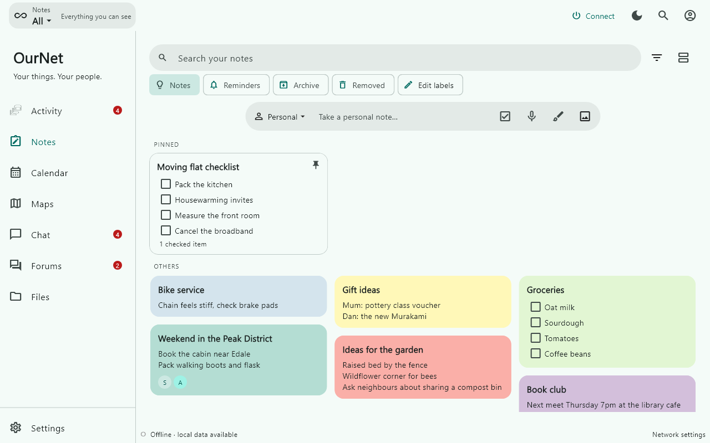
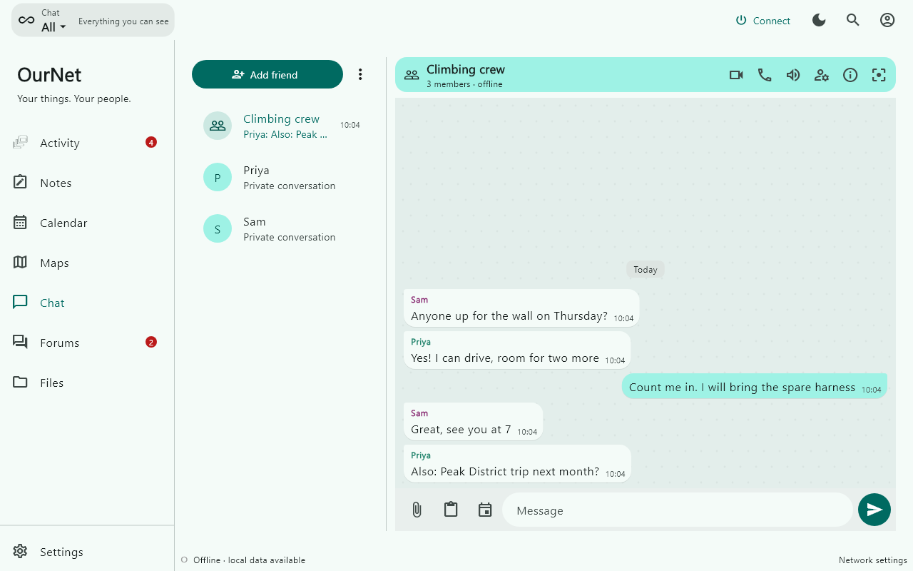
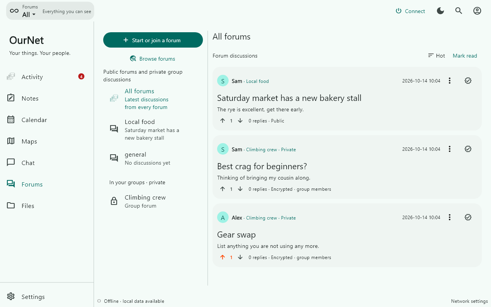
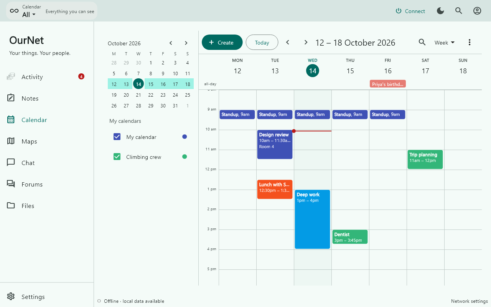
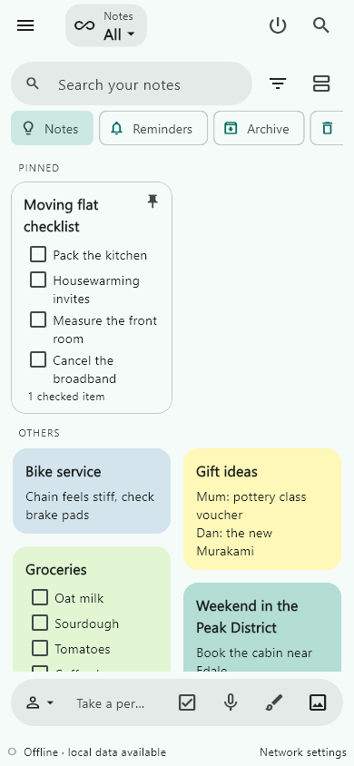
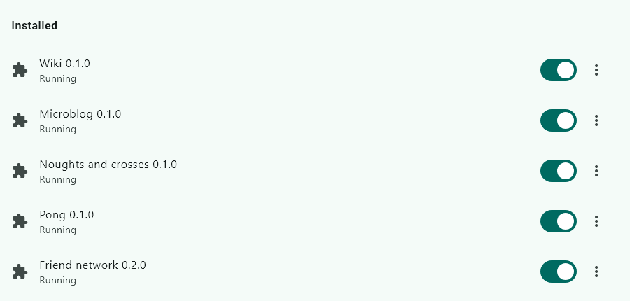
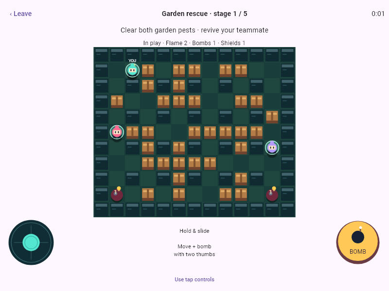

# OurNet

OurNet is a serverless app for notes, chat, forums and calendars. It shares your
data directly between your own devices and the people you trust, with no
central platform in between.



Most communication tools depend on a company's servers: they hold your data,
decide who can reach you, and give you little way to tell where information came
from. OurNet is an alternative built on a **friend-to-friend** (F2F) network,
inspired by RetroShare. Devices connect peer-to-peer, and data only travels
between people who have chosen to connect.

The focus is on **identity, accountability and trust**:

- **Persistent identity.** One identity your friends recognise, across your
  phone and PC, not tied to any device or provider.
- **Accountable, not anonymous.** Content is signed, and every hop that passed
  it along is signed too. An account nobody vouched for has no way in, and
  whoever passes junk along can be seen and dropped, which is how OurNet aims
  to keep out scams, spam and bots without a central moderator. Friend lists
  are public, so OurNet is not an anonymity tool.
- **Trust in context.** Being someone's friend doesn't grant access to
  everything. Folders, groups and lists are encrypted and shared only with the
  people you pick.

> **Status:** early and changing fast. The encryption scheme has not been
> audited. Don't rely on it yet for sensitive data.

## What it does

<table>
  <tr>
    <td width="50%"></td>
    <td width="50%"></td>
  </tr>
  <tr>
    <td width="50%"></td>
    <td width="50%"></td>
  </tr>
</table>

- **Notes and checklists**, Keep-style, including drawings, photos and voice
  notes with on-device transcription ([NOTES.md](docs/NOTES.md)).
- **Chat**: one-to-one and group conversations, with replies, reactions,
  files, and voice and video calls ([MESSAGING.md](docs/MESSAGING.md)).
- **Forums**: public forums and private group forums, with threaded replies
  and voting.
- **Groups** with their own chat, forum, notes, lists and calendar
  ([SCOPES.md](docs/SCOPES.md)).
- **Calendar**: your own plus a private calendar for each group
  ([CALENDAR.md](docs/CALENDAR.md)).
- **Maps** with live location sharing among friends ([MAPS.md](docs/MAPS.md)).
- **Activity**: a feed of what friends did ([ACTIVITY.md](docs/ACTIVITY.md)).
- **Files and private drive sync** across your own devices
  ([PRIVATE_DRIVE.md](docs/PRIVATE_DRIVE.md)).

It runs on Windows and Android. To try it, see [TRY_IT.md](docs/TRY_IT.md).

## Plugins

New features can ship as WebAssembly plugins instead of growing the app. A
plugin reuses OurNet's identity, encryption and friend network without ever
holding keys, and gets only the access its manifest asks for and you grant.
Plugins are signed and can be shared between friends.

<table>
  <tr>
    <td width="50%"></td>
    <td width="50%"></td>
  </tr>
</table>

The first-party plugins are a wiki, a microblog, noughts and crosses, Pong,
Blast Garden and a friend-network VPN. Their sources are in `plugins/`; the
design and API are in [PLUGINS.md](docs/PLUGINS.md) and sharing in
[SHARING.md](docs/SHARING.md).

## Structure

- `core`: pure Dart identity, signatures, encrypted objects, SQLite storage,
  replication, provenance, revocation and the plugin registry.
- `transport`: pure Dart iroh networking, attachment transfer and a headless
  personal node. No Flutter dependency.
- `app`: the Flutter UI, OS key vault, file and clipboard integration,
  notifications and WebRTC calling. Screens are under `lib/ui`.
- `native`: a Rust library for hot crypto, JPEG encoding and the plugin host,
  built by a Dart build hook. The pure-Dart code runs where it isn't built.
- `plugins`: first-party plugin sources and the packer.
- `vendor`: pinned upstream code, with origins in `vendor/README.md`.
- `tool`: setup, run, packaging and release scripts.

## Development

Install Flutter, the Windows C++ build tools for Windows, and the Android
SDK/NDK and Rust Android targets for Android. `flutter doctor` reports what is
missing.

```powershell
.\tool\setup.ps1
cd core; dart test
cd ..\transport; dart test
cd ..\app; flutter test; flutter analyze
flutter run -d windows
```

The core tests load neither iroh nor Flutter. Transport tests run real local
QUIC endpoints. Contributor guidance, including compatibility and performance
rules, is in [AGENTS.md](AGENTS.md) and [PERFORMANCE.md](docs/PERFORMANCE.md).
`tool/run.ps1 -Profile alice` opens a release build with its own identity, so
two profiles can talk to each other on one PC.

For a headless personal node, run `dart run bin/node.dart my-node-data --local`
from `transport`. It stores an encrypted identity vault and SQLite content in
the chosen folder, and accepts `card`, `add <card>`, `sync`,
`subscribe <space>`, `post <text>` and `quit`.

The README screenshots come from
`flutter test test/readme_shots_test.dart --dart-define=README_SHOTS=<folder>`
in `app`, which draws the app with made-up content.

## Product and protocol

[CORE_IDEA.md](docs/CORE_IDEA.md) has the longer-term vision.
[PROTOCOL.md](docs/PROTOCOL.md) and [PROTOCOL_CHANGELOG.md](docs/PROTOCOL_CHANGELOG.md)
describe the wire format, [CONNECTIVITY.md](docs/CONNECTIVITY.md) covers NAT,
offline delivery and friend carriers, and
[RETROSHARE_COMPARISON.md](docs/RETROSHARE_COMPARISON.md) records what we take from
RetroShare. Provenance proves signed statements about recorded actions, not
truth, real-world identity or off-protocol copying. Forward secrecy, identity
recovery and encrypted history migration are still to do.
[PRIVACY.md](PRIVACY.md) is the privacy declaration for the store apps.
Everything else (feature notes, plugin design, testing guides, reviews) is in
[docs/](docs/).

## License

OurNet is licensed under the [GNU Affero General Public License v3.0](LICENSE).
If you run a modified version as a network service, you must offer its source to
the people who use it. Vendored third-party code under `vendor/` keeps its own
licenses (Apache-2.0 for `iroh_mobile`, MIT for `whisper_cpp`).
